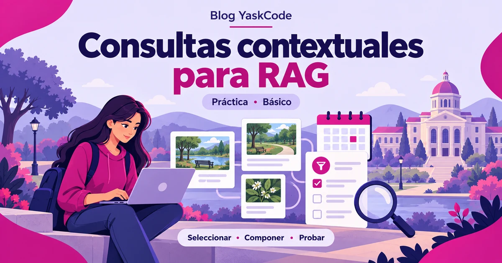
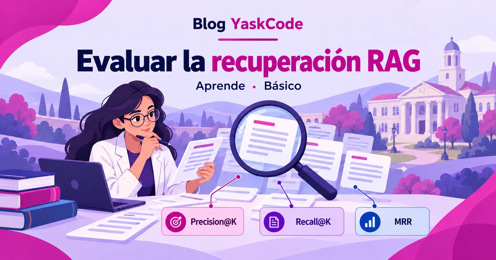
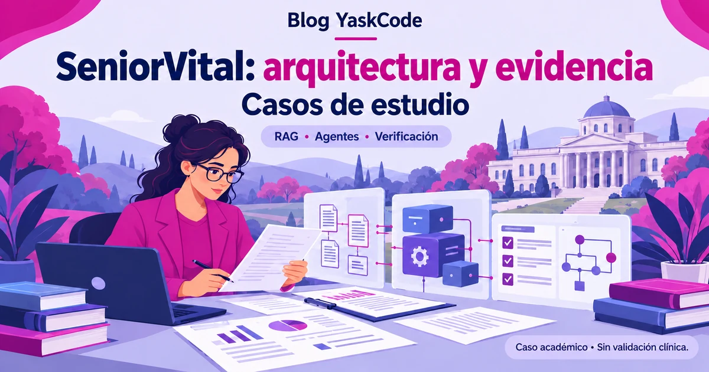

# Revisión de portadas · 1 de noviembre de 2026

Base inspeccionada: `main` en `d66198592ac1f43ddb2be8675ca0f1359a0f919f`. Doce artículos, cinco portadas existentes y siete ausentes al inicio. Resultado: doce WebP de 1200 × 630. Sin cambios en títulos, fechas, autorías, niveles, categorías o contenido académico; solo se cambia la referencia de imagen visible de Hugging Face al WebP equivalente.

## Inventario y decisiones

Los enlaces de artículo apuntan a la publicación actual; las nuevas portadas solo existen en esta rama hasta aprobar y publicar.

| Artículo | Portada inicial | Estado | Procedencia | Acción y archivo final |
|---|---|---|---|---|
| 1. [Campus YaskCode: cuando la universidad inspira un espacio digital para aprender, investigar y construir](https://yaskcode-community.github.io/yaskcode-blog/posts/historia-campus-yaskcode/) | `campus-yaskcode-portada.webp` | Existente | Campus original aportado por la autora | Conservar sin cambios; [WebP](../posts/historia-campus-yaskcode/campus-yaskcode-portada.webp) (107.0 KiB) |
| 2. [Si la IA genera código, ¿por qué aprender Programación Orientada a Objetos?](https://yaskcode-community.github.io/yaskcode-blog/posts/por-que-aprender-poo-en-la-era-de-la-ia/) | `portada-poo-ia.webp` | Existente | Diseño con IA documentado en el artículo | Conservar sin cambios; [WebP](../posts/por-que-aprender-poo-en-la-era-de-la-ia/portada-poo-ia.webp) (51.2 KiB) |
| 3. [RAG: fundamentos y arquitectura para comenzar](https://yaskcode-community.github.io/yaskcode-blog/posts/rag-fundamentos-arquitectura/) | `portada-rag-yaskcode-renovada.webp` | Existente | Diseño con IA documentado en el artículo | Conservar sin cambios; [WebP](../posts/rag-fundamentos-arquitectura/portada-rag-yaskcode-renovada.webp) (58.8 KiB) |
| 4. [Hugging Face: modelos, datasets y herramientas para comenzar en Ciencia de Datos](https://yaskcode-community.github.io/yaskcode-blog/posts/hugging-face-modelos-datasets-ciencia-de-datos/) | `portada-hugging-face.png` | Existente; ajuste técnico | Original con IA aprobado, según image-description e historial 5fc6f52 | PNG → WebP; diseño conservado; [WebP](../posts/hugging-face-modelos-datasets-ciencia-de-datos/portada-hugging-face.webp) (75.0 KiB) |
| 5. [Ruta de aprendizaje YaskCode: de RAG a sistemas multiagentes y su evaluación](https://yaskcode-community.github.io/yaskcode-blog/posts/ruta-aprendizaje-yaskcode-rag-sistemas-multiagentes/) | `Sin portada` | Pendiente en main → incorporada | Archivo aprobado aportado por la autora; no regenerado | Copiar archivo aprobado sin alterar bytes; [WebP](../posts/ruta-aprendizaje-yaskcode-rag-sistemas-multiagentes/portada-ruta-aprendizaje-yaskcode.webp) (130.6 KiB) |
| 6. [Cómo leer críticamente un caso de IA: evidencia, arquitectura y límites](https://yaskcode-community.github.io/yaskcode-blog/posts/leer-criticamente-caso-ia-evidencia-arquitectura-limites/) | `Sin portada` | Pendiente en main → incorporada | Archivo aprobado aportado por la autora; no regenerado | Copiar archivo aprobado sin alterar bytes; [WebP](../posts/leer-criticamente-caso-ia-evidencia-arquitectura-limites/portada-leer-criticamente-caso-ia-evidencia-arquitectura-limites.webp) (156.8 KiB) |
| 7. [RunCoach AI: del conocimiento documentado a un RAG trazable](https://yaskcode-community.github.io/yaskcode-blog/posts/runcoach-ai-conocimiento-rag-caso/) | `portada-runcoach-ai-rag.webp` | Existente; resolución insuficiente | Original generado con IA recuperado y comparado visualmente | 450 × 236 → 1200 × 630 desde original, mismo diseño; [WebP](../posts/runcoach-ai-conocimiento-rag-caso/portada-runcoach-ai-rag.webp) (79.3 KiB) |
| 8. [Práctica: construir consultas contextuales para RAG y probar sus casos límite](https://yaskcode-community.github.io/yaskcode-blog/posts/runcoach-rag-consultas-contextuales-practica/) | `Sin portada` | Pendiente en main → diseñada | Generación con IA en esta revisión | Nueva propuesta conceptual para aprobación; [WebP](../posts/runcoach-rag-consultas-contextuales-practica/portada-consultas-contextuales-rag.webp) (102.7 KiB) |
| 9. [Cómo evaluar la recuperación RAG: Precision@K, Recall@K y MRR](https://yaskcode-community.github.io/yaskcode-blog/posts/evaluar-recuperacion-rag-precision-recall-mrr/) | `Sin portada` | Pendiente en main → diseñada | Generación con IA en esta revisión | Nueva propuesta conceptual para aprobación; [WebP](../posts/evaluar-recuperacion-rag-precision-recall-mrr/portada-metricas-recuperacion-rag.webp) (96.6 KiB) |
| 10. [SeniorVital: RAG, agentes y evidencia en un proyecto académico](https://yaskcode-community.github.io/yaskcode-blog/posts/seniorvital-rag-agentes-evidencia-caso/) | `Sin portada` | Pendiente en main → diseñada | Generación con IA en esta revisión | Nueva propuesta conceptual para aprobación; [WebP](../posts/seniorvital-rag-agentes-evidencia-caso/portada-seniorvital-arquitectura-evidencia.webp) (113.6 KiB) |
| 11. [Práctica: verificar evidencia y abstenerse antes de responder con RAG](https://yaskcode-community.github.io/yaskcode-blog/posts/seniorvital-evidencia-abstencion-rag-practica/) | `Sin portada` | Pendiente en main → diseñada | Generación con IA en esta revisión | Nueva propuesta conceptual para aprobación; [WebP](../posts/seniorvital-evidencia-abstencion-rag-practica/portada-evidencia-abstencion-rag.webp) (89.2 KiB) |
| 12. [De RAG a sistemas multiagentes: responsabilidades y supervisión](https://yaskcode-community.github.io/yaskcode-blog/posts/de-rag-a-sistemas-multiagentes-responsabilidades-supervision/) | `Sin portada` | Pendiente en main → diseñada | Generación con IA en esta revisión | Nueva propuesta conceptual para aprobación; [WebP](../posts/de-rag-a-sistemas-multiagentes-responsabilidades-supervision/portada-sistemas-multiagentes-supervision.webp) (91.7 KiB) |

## Recursos revisados

Se inspeccionaron AGENTS.md, la guía editorial, los doce index.qmd, los recursos gráficos del blog, tarjetas, estilos, configuración Quarto, metadatos SEO y workflows. POO, RAG y Hugging Face declaran asistencia de IA; Campus declara procedencia original. RunCoach declara una ilustración conceptual, no una captura del proyecto.

Se revisó el árbol público del repositorio académico wellness-platform-team1 (8a2c7e4d3c3a9285bbdca9b2dc2bbedf1d8255e2): contiene logotipos, hero e iconos de interfaz, pero no una portada del laboratorio de consultas contextuales. El laboratorio usa un parque ficticio, no la aplicación estudiantil. No se reutilizan esos recursos sin verificar sus derechos. El artículo de SeniorVital remite a documentación académica y no expone una fuente pública autorizada de imágenes; no se accedió a materiales privados. Para estos temas se preparan ilustraciones conceptuales propias, sin afirmar que sean diagramas reales o resultados.

## Relación con el PR #46

El PR #46 sigue abierto y en borrador. Incluye cambios editoriales de cronología y navegación ajenos a esta revisión, y declara la portada de la ruta sin su archivo. Este PR de portadas parte de main, reutiliza el mismo nombre y texto alternativo de la ruta y aporta el binario aprobado. No duplica ni incorpora los otros cambios del #46. Antes de integrar el #46 habrá que actualizar su rama sobre main, conservar una sola declaración de image/image-alt y retirar su comentario de archivo pendiente. No se fusiona ninguno sin aprobación.

## Accesibilidad y SEO

Las doce portadas tienen image-alt descriptivo. Las imágenes de tarjetas conservan alt vacío y enlace aria-hidden porque son decorativas junto al título enlazado; así se evita duplicar el anuncio a lectores de pantalla. Las alternativas descriptivas se transmiten a Open Graph y Twitter mediante Quarto. Se conserva la proporción 1200/630 existente y las etiquetas Comunidad YaskCode y Casos de estudio.

Quarto sigue siendo la única fuente de etiquetas Open Graph y Twitter Card. Los archivos SEO específicos solo añaden la URL correspondiente en BlogPosting JSON-LD. No se agregan etiquetas sociales manuales duplicadas. Las fechas SEO existentes se conservan.

## Validación

- Quarto 1.10.20: render normal correcto.
- scripts/check_site.py: 14 páginas, enlaces y recursos locales disponibles.
- scripts/check_covers.py: 12 portadas; correspondencia entre archivos, tarjetas, Open Graph, Twitter y JSON-LD; alternativas y ausencia de duplicados.
- tests/test_pagination.cjs: paginación 9/3, búsqueda global, filtros, URL y estado vacío correctos.
- Comparación programática contra main: títulos, autorías, fechas, niveles, categorías y cuerpos académicos conservados.
- Las dos imágenes aprobadas mantienen sus bytes originales.
- Revisión visual de los cinco diseños realizada; corregidos nivel Básico de métricas y vestimenta de SeniorVital.
- Render de revisión y sus comprobaciones: correctos.
- Navegador local: Chromium no puede arrancar en este entorno (SIGSEGV incluso al consultar su versión). Se añade comprobación equivalente en GitHub Actions con capturas de escritorio y móvil como artefacto cover-review. Resultado de CI pendiente.

## Propuestas nuevas

Las imágenes son ilustraciones conceptuales generadas con la herramienta integrada de imágenes, no evidencia experimental. SeniorVital indica expresamente «Sin validación clínica». Los títulos cortos de las portadas no cambian los títulos de los artículos.

### Práctica: construir consultas contextuales para RAG y probar sus casos límite

### Cómo evaluar la recuperación RAG: Precision@K, Recall@K y MRR

### SeniorVital: RAG, agentes y evidencia en un proyecto académico

### Práctica: verificar evidencia y abstenerse antes de responder con RAG

### De RAG a sistemas multiagentes: responsabilidades y supervisión

## Prompts de generación y correcciones

### consultas

Portada editorial horizontal de Blog YaskCode, proporción 1200:630. Ilustración digital con apariencia vectorial académica, magenta, violeta, azul y blanco, fondo claro lavanda, colinas suaves y universidad estilizada al fondo, formas curvas magenta en esquinas, contornos limpios, sombras suaves. Título grande oscuro y magenta legible en mitad superior, escena en mitad inferior, márgenes seguros. Texto exacto: "Blog YaskCode", "Consultas contextuales para RAG", "Práctica · Básico". Universitaria con portátil, fichas de observación de un parque, calendario, filtro de notas y lupa. Texto secundario: Seleccionar · Componer · Probar. No robots ni embeddings: laboratorio Python previo a recuperación. Coherente con las portadas aprobadas descritas, diseño elegante. No marcas de terceros, no porcentajes, no resultados reales, no texto adicional.

### metricas

Portada editorial horizontal de Blog YaskCode, proporción 1200:630. Ilustración digital con apariencia vectorial académica, magenta, violeta, azul y blanco, fondo claro lavanda, colinas suaves y universidad estilizada al fondo, formas curvas magenta en esquinas, contornos limpios, sombras suaves. Título grande oscuro y magenta legible en mitad superior, escena en mitad inferior, márgenes seguros. Texto exacto: "Blog YaskCode", "Evaluar la recuperación RAG", "Aprende · Intermedio". Investigadora revisando tarjetas de documentos y lupa. Tres rótulos claros: Precision@K, Recall@K, MRR. Ilustración conceptual, no gráficos numéricos, no puntuaciones ni resultados inventados. Coherente con las portadas aprobadas descritas, diseño elegante. No marcas de terceros, no porcentajes, no resultados reales, no texto adicional.

### seniorvital

Portada editorial horizontal de Blog YaskCode, proporción 1200:630. Ilustración digital con apariencia vectorial académica, magenta, violeta, azul y blanco, fondo claro lavanda, colinas suaves y universidad estilizada al fondo, formas curvas magenta en esquinas, contornos limpios, sombras suaves. Título grande oscuro y magenta legible en mitad superior, escena en mitad inferior, márgenes seguros. Texto exacto: "Blog YaskCode", "SeniorVital: arquitectura y evidencia", "Casos de estudio". Investigadora inspecciona documentos, módulos tecnológicos y registro de ejecución. Texto secundario: RAG · Agentes · Verificación. Nota legible: Caso académico · Sin validación clínica. No médicos, pacientes, estetoscopios, cruces médicas ni promesas de bienestar. Coherente con las portadas aprobadas descritas, diseño elegante. No marcas de terceros, no porcentajes, no resultados reales, no texto adicional.

### abstencion

Portada editorial horizontal de Blog YaskCode, proporción 1200:630. Ilustración digital con apariencia vectorial académica, magenta, violeta, azul y blanco, fondo claro lavanda, colinas suaves y universidad estilizada al fondo, formas curvas magenta en esquinas, contornos limpios, sombras suaves. Título grande oscuro y magenta legible en mitad superior, escena en mitad inferior, márgenes seguros. Texto exacto: "Blog YaskCode", "Evidencia antes de responder", "Práctica · Básico". Estudiante con portátil revisa documentos de una convocatoria universitaria ficticia, lupa y una tarjeta de pausa con interrogación. Texto secundario: Verificar fuentes · Abstenerse · Probar. No doctores ni pacientes, no robots. Coherente con las portadas aprobadas descritas, diseño elegante. No marcas de terceros, no porcentajes, no resultados reales, no texto adicional.

### multiagentes

Portada editorial horizontal de Blog YaskCode, proporción 1200:630. Ilustración digital con apariencia vectorial académica, magenta, violeta, azul y blanco, fondo claro lavanda, colinas suaves y universidad estilizada al fondo, formas curvas magenta en esquinas, contornos limpios, sombras suaves. Título grande oscuro y magenta legible en mitad superior, escena en mitad inferior, márgenes seguros. Texto exacto: "Blog YaskCode", "Sistemas multiagentes", "Aprende · Intermedio". Supervisora humana con portátil y tres pequeños asistentes tecnológicos distintos con iconos de documentos, herramientas y revisión; globos de mensajes. Ilustración conceptual, no diagrama de arquitectura específico. Texto secundario: Responsabilidades · Comunicación · Supervisión. Coherente con las portadas aprobadas descritas, diseño elegante. No marcas de terceros, no porcentajes, no resultados reales, no texto adicional.

Correcciones posteriores: métricas cambia únicamente «Intermedio» a «Básico»; SeniorVital sustituye la chaqueta blanca por un blazer magenta. Las versiones corregidas son las incorporadas.
