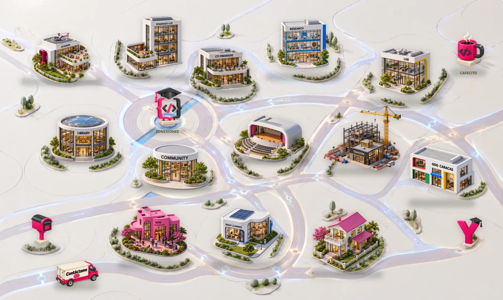

*Comunidad YaskCode · Historia de origen · Experiencia educativa*

{fig-alt="Vista panorámica ilustrada de Campus YaskCode con espacios digitales dedicados a docencia, investigación, proyectos y comunidad. Los edificios se conectan mediante una red de caminos."}

## 1. Una universidad es mucho más que sus aulas

Cuando pienso en la universidad, no imagino solamente salones de clase. Pienso también en los laboratorios donde una idea se convierte en experimento, en las bibliotecas que acompañan una búsqueda, en los proyectos que reúnen a distintas personas y en las conversaciones que abren nuevas preguntas.

Para mí, estudiar Computación no ha sido nunca únicamente aprender conceptos o escribir programas. La formación universitaria también sucede cuando compartimos un problema, discutimos una solución, revisamos el trabajo de otros o descubrimos que una investigación puede convertirse en un proyecto útil.

Una universidad es, sobre todo, un **ecosistema de aprendizaje**. Sus espacios tienen propósitos distintos, pero adquieren un sentido más profundo cuando se conectan. Esa forma de entender la vida académica está en el origen de Campus YaskCode.

## 2. Lo que la pandemia nos hizo extrañar

Durante la pandemia, las tecnologías digitales permitieron que muchas actividades educativas continuaran. Como profesora universitaria de Computación, pude observar el valor de mantener abiertas esas posibilidades cuando reunirnos físicamente no era posible.

Sin embargo, también percibí lo que se debilitaba. La universidad no se reduce a recibir materiales o asistir a una clase: implica encontrarse con otras personas, experimentar, colaborar, investigar y sentirse parte de un entorno académico compartido.

Al regresar a la presencialidad, las dificultades relacionadas con la infraestructura y su mantenimiento hicieron evidente que recuperar esa experiencia no dependía solamente de volver a ocupar los edificios. Había necesidades de conexión, participación y continuidad que seguían presentes.

No pensé que una página web pudiera sustituir al campus físico. La pregunta era otra: **¿podríamos aprovechar lo digital para conservar y ampliar algunas de esas conexiones?**

## 3. Una pregunta que comenzó a tomar forma

La inquietud fue tomando una forma sencilla:

**¿Cómo podemos preservar y ampliar la experiencia de un campus universitario cuando el aprendizaje también ocurre fuera de sus edificios?**

Quería un lugar al que estudiantes de pregrado y posgrado, docentes, investigadores y personas de comunidades tecnológicas pudieran llegar para descubrir recursos, comprender el propósito de cada iniciativa y encontrar caminos para participar.

No bastaba con reunir enlaces. Un conjunto de enlaces puede ser útil, pero no siempre muestra por qué existen esas iniciativas o qué relación guardan entre sí. Me interesaba representar algo más cercano a la experiencia de recorrer una universidad: reconocer sus espacios y entender que cada uno invita a aprender de una manera diferente.

De esa reflexión surgió la metáfora que guía el proyecto.

## 4. Así nació Campus YaskCode

Imaginé mi sitio académico personal como un **campus universitario digital e interactivo**, dedicado a la Computación y a la Ingeniería de Software.

Cada edificio representaría una dimensión del trabajo académico. Los caminos no serían solamente decoración: servirían para recordar que la docencia, la investigación, la extensión, los proyectos y el crecimiento profesional están relacionados.

Así nació [Campus YaskCode](https://yaskelly.github.io/). En lugar de presentar mi trayectoria como una sucesión de apartados aislados, el Campus propone un recorrido visual por iniciativas que se complementan. La idea no es imitar una universidad real ni reemplazarla, sino hacer visible una forma de conectar experiencias educativas presenciales y virtuales.

También quise que el proyecto conservara un carácter abierto: un lugar comprensible para quien llega por primera vez y, al mismo tiempo, capaz de crecer con nuevos recursos y colaboraciones.

## 5. Un recorrido por los espacios del Campus

En el Campus, los espacios de **formación y acompañamiento** aparecen conectados. **YaskCode Academy** reúne propuestas educativas; **Posgrado LUZ** y **CTI Pregrado** recuerdan la importancia del acompañamiento académico, los trabajos de investigación y los proyectos estudiantiles. **Smart Learning** representa una línea de exploración sobre ecosistemas digitales de aprendizaje, todavía en evolución.

Otros edificios abren caminos para **investigar y experimentar**. **YaskCode Research** da lugar a la investigación y la mentoría; **YaskCode Laboratory** está asociado a prototipos y exploración tecnológica. La **Library** acerca materiales y documentación, mientras que el **Auditorio** evoca el intercambio de ideas mediante charlas y actividades.

También quise representar la **vida comunitaria**. **YaskCode Community**, **GDG Caracas** y **WTM + Technovation** reflejan distintas oportunidades para encontrarse, aprender con otras personas y participar en iniciativas tecnológicas.

El **Parque de Innovación y Tecnología** recuerda que hay proyectos en desarrollo: es un espacio marcado *en construcción*, no una promesa de que todo esté terminado. La **Casa de Yaskelly** ofrece una entrada a mi trayectoria personal. La entrada principal, las rutas de conexiones profesionales y otros elementos del recorrido enlazan estas dimensiones.

Podría describir cada edificio por separado, pero lo más importante es lo que ocurre entre ellos: **los caminos permiten entender un proyecto académico como parte de una experiencia compartida**.

## 6. Aprender, investigar, construir y compartir

La filosofía educativa de YaskCode se expresa en cuatro acciones: **Aprende · Practica · Construye · Comparte**.

Aprender ofrece fundamentos para comprender un problema. Practicar permite poner a prueba las ideas. Construir exige tomar decisiones y asumir la calidad de lo que se desarrolla. Compartir abre la posibilidad de recibir observaciones, reconocer errores y contribuir al aprendizaje de otros.

En Ingeniería de Software, estas acciones se relacionan de manera natural. Un proyecto puede comenzar en el aula, apoyarse en recursos de la biblioteca, avanzar mediante un prototipo, incorporar documentación y control de versiones, y convertirse en una experiencia para discutir con la comunidad.

Herramientas como GitHub, los repositorios, la revisión colaborativa y la integración continua pueden apoyar ese recorrido. Pero el valor educativo no reside en utilizar una herramienta por sí misma: está en **comprender el proceso, justificar las decisiones y aprender a trabajar con otras personas de manera responsable**.

Eso es lo que quise representar en el Campus: no solo lugares para consultar, sino relaciones que invitan a aprender haciendo.

## 7. Un Campus que continúa creciendo

Campus YaskCode no nació como una obra terminada. Es un proyecto que evoluciona conforme crecen sus iniciativas, materiales y posibilidades de colaboración.

Algunos espacios conectan con recursos que ya pueden recorrerse. Otros muestran ideas, experiencias piloto o proyectos que todavía están en desarrollo. Prefiero mantener esa distinción visible antes que presentar posibilidades futuras como logros alcanzados.

La experiencia también me ha enseñado a pensar el sitio como un lugar que debe revisarse: sus recorridos, su accesibilidad, sus contenidos y la claridad con la que invita a participar pueden mejorar con el tiempo.

Quizás esa sea una de las ideas más cercanas a la vida universitaria: **un campus siempre está aprendiendo a ser mejor**.

## 8. Una invitación a recorrerlo

Si eres estudiante, docente, investigador o simplemente alguien con curiosidad por la Computación, me gustaría que recorras este espacio con la misma disposición con la que entrarías a una biblioteca, a un laboratorio o a una conversación que puede enseñarte algo nuevo.

Puedes comenzar por el edificio que despierte tu interés y descubrir, poco a poco, sus conexiones con los demás. No es necesario conocer todo el ecosistema para encontrar un primer camino.

[**Explora Campus YaskCode**](https://yaskelly.github.io/)

Al final, mi motivación sigue siendo la misma: que la formación en Computación no se reduzca a contenidos separados, sino que permita **aprender, investigar, colaborar y construir software con calidad y responsabilidad**.

Porque la universidad es mucho más que sus edificios. Es también lo que construimos y compartimos entre quienes aprendemos en ella.

---

*Nota de origen:* este relato se inspira en la respuesta que escribí el 12 de octubre de 2026 para explicar la motivación de mi sitio académico personal en el **Best Personal Academic Websites Contest 2026**. El Campus y sus áreas se describen de acuerdo con el proyecto disponible en su repositorio; algunas iniciativas permanecen en desarrollo.
