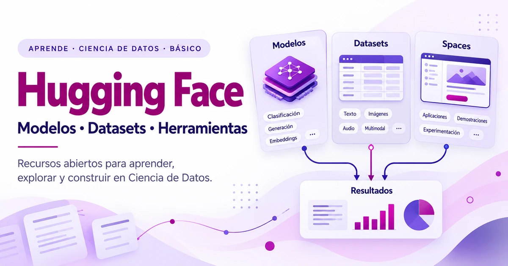

{fig-alt="Ilustración en blanco, magenta y lavanda: tres tarjetas de modelos, datasets y aplicaciones conectadas con un panel de resultados."}

::: {.callout-note title="En 1 minuto"}
**Hugging Face Hub** permite explorar modelos, conjuntos de datos y aplicaciones demostrativas (*Spaces*). Transformers y otras bibliotecas facilitan su uso, pero encontrar un recurso no significa que sea adecuado: antes de utilizarlo revisa su tarjeta, procedencia, licencia, limitaciones y requisitos.
:::

::: {.callout-tip title="Lo que aprenderás"}
Al finalizar la lectura podrás:

1. **Explicar** qué es Hugging Face y qué papel cumple Hugging Face Hub en proyectos de Ciencia de Datos.
2. **Diferenciar** modelos, datasets, Spaces y bibliotecas de software.
3. **Reconocer** para qué sirven Transformers y las bibliotecas principales del ecosistema.
4. **Interpretar** la información esencial de una Model Card y una Dataset Card.
5. **Identificar** criterios básicos para seleccionar modelos y datos de manera responsable.
:::

### Antes de comenzar

**Conocimientos previos:** no necesitas experiencia con Hugging Face ni programación previa para comprender los conceptos. Es recomendable conocer nociones generales de inteligencia artificial, aprendizaje automático (*machine learning*) y Ciencia de Datos.

**Público destinatario:** estudiantes universitarios, docentes, investigadores y personas que comienzan en Ciencia de Datos e Inteligencia Artificial.


::: {.callout-tip title="Recursos para llevar"}
<a href="../../recursos/hugging-face-modelos-datasets-ciencia-de-datos-ficha.md" download>Descargar ficha de lectura (.md)</a> · La opción «Imprimir o guardar como PDF» aparecerá junto al encabezado.

La ficha sintetiza las ideas clave y propone preguntas para revisar la comprensión; **no sustituye un laboratorio**.
:::


## 1. ¿Por qué Hugging Face es importante para la Ciencia de Datos?

Imagina que un estudiante desea identificar temas frecuentes en comentarios sobre una asignatura. Puede plantearse dos caminos: recopilar muchos ejemplos y desarrollar un modelo desde cero, o explorar primero si existe un modelo preentrenado que sirva como punto de partida. En ambos casos también necesita comprender **qué datos utilizará, cómo evaluará los resultados y qué límites tendrá su análisis**.

Trabajar en Ciencia de Datos no significa escoger automáticamente la herramienta más sofisticada. Significa formular una pregunta, obtener datos adecuados, seleccionar métodos y **comprobar si las conclusiones están justificadas**. Para aprender ese proceso, contar con modelos y conjuntos de datos documentados resulta útil: permite concentrarse en la pregunta de investigación antes de resolver todos los detalles de entrenamiento.

El ecosistema [Hugging Face](https://huggingface.co/) reúne recursos que facilitan el descubrimiento, el estudio y la reutilización de sistemas de aprendizaje automático. Esa disponibilidad no garantiza por sí sola calidad ni validez científica: **encontrar un modelo es el comienzo de una evaluación, no su final** [1].

## 2. ¿Qué es Hugging Face?

**Hugging Face** es una organización y un ecosistema tecnológico conocido por alojar y conectar modelos de aprendizaje automático, datasets, aplicaciones de demostración, herramientas de desarrollo y materiales educativos. Su componente de descubrimiento y colaboración es **Hugging Face Hub** [1].

Conviene distinguir cuatro planos que a menudo se confunden:

- **Plataforma y repositorios:** el **Hub** organiza y permite compartir recursos, versiones, archivos y documentación.
- **Artefactos:** un **modelo** es un sistema entrenado; un **dataset** es una colección estructurada de datos. No son lo mismo que una biblioteca.
- **Bibliotecas de software:** proyectos como **Transformers**, **Datasets** y **huggingface_hub** ayudan a trabajar con esos recursos desde programas.
- **Servicios de ejecución:** ciertas aplicaciones o proveedores permiten probar inferencias sin configurar todo localmente; las condiciones de uso dependen de la opción elegida.

::: {.callout-important title="Público, gratuito y abierto no significan lo mismo"}
Un repositorio puede ser **públicamente visible** sin autorizar todos los usos de sus archivos. Un recurso puede ser **gratuito para consultar**, pero requerir hardware de pago para ejecutarlo. Un modelo puede distribuir pesos descargables bajo una licencia con **condiciones específicas**. También hay recursos privados y de acceso restringido (*gated*). Comprueba la licencia y las condiciones del recurso concreto antes de reutilizarlo [1, 8].
:::

## 3. Conociendo Hugging Face Hub

En el [Hub](https://huggingface.co/docs/hub) encontrarás tres entradas especialmente útiles para empezar: [Models](https://huggingface.co/models), [Datasets](https://huggingface.co/datasets) y [Spaces](https://huggingface.co/spaces). No corresponden a tres maneras de llamar a la misma cosa.

| Componente | ¿Qué encontrarás? | Pregunta útil para aprender | Ejemplo educativo |
|:--|:--|:--|:--|
| **Models** | Pesos, configuraciones, documentación y metadatos de modelos | ¿Existe un modelo adecuado para esta tarea? | Examinar un clasificador de opiniones |
| **Datasets** | Datos, particiones y documentación de su procedencia y uso | ¿Con qué información podría entrenar o evaluar? | Explorar reseñas etiquetadas |
| **Spaces** | Aplicaciones interactivas y demostraciones | ¿Cómo se comporta una aplicación ante diferentes entradas? | Probar una búsqueda de imágenes |

La exploración inicial puede hacerse desde el navegador. En **Models** se puede filtrar por tarea, idioma o biblioteca; en **Datasets**, inspeccionar características y, cuando el repositorio lo permite, una vista previa; en **Spaces**, observar la interfaz de una aplicación. La presencia de filtros o vistas previas **no sustituye la lectura de documentación** [1, 5].

Una observación importante: un mismo proyecto podría disponer de un modelo, un dataset de evaluación y un Space de demostración. Son **recursos relacionados**, pero cada uno tiene finalidad, requisitos y condiciones propias.

## 4. Modelos preentrenados: aprovechar conocimiento existente

Un **modelo preentrenado** es un modelo cuyos parámetros ya fueron aprendidos a partir de datos mediante un proceso previo. Según su arquitectura y entrenamiento, puede reconocer patrones en texto, imágenes, audio u otras modalidades. Al reutilizarlo, no necesitas repetir obligatoriamente ese entrenamiento inicial.

**Inferencia** es el proceso de aplicar el modelo a una nueva entrada para obtener una salida: por ejemplo, clasificar una reseña como positiva o negativa. Que un modelo produzca una etiqueta no demuestra automáticamente que la etiqueta sea correcta o pertinente para el contexto.

La diferencia esencial es la siguiente:

| Actividad | ¿Qué ocurre? | ¿Es necesario ajustar los parámetros? |
|:--|:--|:--|
| **Usar un modelo para inferencia** | Se aplica un modelo existente a entradas nuevas | Normalmente, no |
| **Entrenar desde cero** | Se aprenden parámetros a partir de un conjunto de entrenamiento | Sí |
| **Fine-tuning (ajuste fino)** | Se continúa el entrenamiento de un modelo existente para adaptarlo a una tarea o dominio | Sí, al menos una parte de los parámetros o parámetros adicionales |

Un ejemplo real para inspeccionar es [`distilbert/distilbert-base-uncased-finetuned-sst-2-english`](https://huggingface.co/distilbert/distilbert-base-uncased-finetuned-sst-2-english), destinado a clasificación de sentimientos **en inglés**. Su página identifica la tarea, el idioma y una licencia. No sería riguroso asumir que dará el mismo rendimiento con comentarios universitarios escritos en español o con expresiones locales [9].

Otros usos de modelos preentrenados incluyen clasificar documentos por tema, identificar entidades en textos o generar representaciones numéricas para buscar información. **Cada tarea requiere una evaluación distinta**: no se elige un modelo de generación de texto solo porque se necesite clasificar opiniones.

## 5. Datasets: los datos como recurso de aprendizaje

Un **dataset** es un conjunto organizado de observaciones, generalmente con campos o atributos. Puede reunir reseñas y sus etiquetas, documentos académicos con categorías, imágenes y anotaciones, fragmentos de audio o datos tabulares. Su utilidad depende de la **procedencia, calidad, representatividad y pertinencia** para la pregunta planteada.

En aprendizaje automático suelen distinguirse tres particiones:

- **`train` (entrenamiento):** ejemplos a partir de los cuales el modelo aprende o se ajusta.
- **`validation` (validación):** ejemplos separados que ayudan a elegir configuraciones y comparar alternativas durante el desarrollo.
- **`test` (prueba):** datos reservados para la evaluación final, evitando utilizarlos repetidamente para tomar decisiones de diseño.

No todos los datasets se publican con esas tres particiones. Algunos tienen solo `train` y `test`, otros incluyen divisiones adicionales y algunos no tienen etiquetas. **No se debe inventar una partición inexistente** ni tratar el conjunto de prueba como si fuera el de entrenamiento.

Por ejemplo, el dataset [`stanfordnlp/imdb`](https://huggingface.co/datasets/stanfordnlp/imdb) reúne reseñas de películas en inglés para tareas de sentimiento. Su ficha permite revisar columnas, etiquetas, divisiones y condiciones de uso. Es un recurso para **inspeccionar y valorar**, no una prueba de que sirva sin adaptaciones para analizar opiniones de estudiantes universitarios [10].

### ¿Cómo explorar conceptualmente un dataset en el Hub?

1. Identifica **la pregunta** a la que podrían ayudar a responder los datos.
2. Abre el repositorio del dataset y revisa su **Dataset Card**.
3. Examina los campos, tipos de datos, idioma y particiones disponibles.
4. Utiliza la vista previa (*Dataset Viewer*), **si está disponible**, para reconocer ejemplos y posibles problemas.
5. Comprueba procedencia, licencia, privacidad, criterios de anotación y limitaciones antes de descargar o reutilizar.

Esta revisión no exige escribir código. Su producto es una **decisión argumentada**: usar, descartar o investigar mejor el recurso.

## 6. Transformers y las principales bibliotecas

Aunque el Hub permite encontrar recursos, las **bibliotecas** proporcionan funcionalidades para utilizarlos desde aplicaciones y proyectos de investigación:

| Biblioteca | ¿Para qué sirve? | No debe confundirse con… |
|:--|:--|:--|
| [**Transformers**](https://huggingface.co/docs/transformers) | Cargar y utilizar modelos compatibles para tareas de texto, visión, audio y otras modalidades; incluye interfaces para inferencia y entrenamiento | Un único modelo o la plataforma Hub |
| [**Datasets**](https://huggingface.co/docs/datasets) | Cargar, inspeccionar, transformar y procesar conjuntos de datos | El catálogo de datasets, que es parte del Hub |
| [**huggingface_hub**](https://huggingface.co/docs/huggingface_hub/index) | Acceder a repositorios, archivos y servicios del Hub mediante herramientas y API de Python | Una biblioteca especializada en entrenar modelos |

**Transformers** ofrece el concepto de **`pipeline`**: una interfaz que organiza pasos habituales, como preparar la entrada, ejecutar un modelo y presentar su salida para tareas compatibles. El nombre no significa que todas las tareas se resuelvan automáticamente ni que cualquier modelo sirva para cualquier entrada [2, 3].

```{mermaid}
%%| fig-cap: "Figura 1. Relación conceptual entre recursos del Hub, procesamiento e inferencia. La evaluación de resultados sigue siendo necesaria."
%%| fig-alt: "Un dataset proporciona datos; un modelo preentrenado se selecciona desde el Hub; una biblioteca coordina la preparación, la inferencia y la presentación de resultados; la persona revisa su calidad."
flowchart LR
  A["Dataset: datos"] --> B["Entrada de ejemplo"]
  C["Modelo preentrenado"] --> D["Biblioteca / pipeline"]
  B --> D
  D --> E["Inferencia"]
  E --> F["Resultado"]
  F --> G["Revisión humana y evaluación"]
```

*El diagrama es didáctico: usar un modelo existente no implica reentrenarlo y el flujo puede variar según la tarea y la arquitectura.*

En el próximo artículo **Practica** trabajaremos estos conceptos con un ejemplo guiado. Aquí lo importante es comprender **qué papel cumple cada pieza**.

## 7. Spaces: aprender explorando aplicaciones

Los [Hugging Face Spaces](https://huggingface.co/docs/hub/spaces) permiten alojar y compartir aplicaciones interactivas. Como visitante puedes explorar algunas demostraciones sin preparar un entorno de programación, aunque ciertos Spaces exigen autenticación, permisos, hardware o servicios adicionales.

Dos ejemplos existentes para observar distintas finalidades son:

- [**Semantic Image Search** de Xenova](https://huggingface.co/spaces/Xenova/semantic-image-search): una demostración relacionada con la búsqueda de imágenes mediante descripciones; invita a pensar qué significa una coincidencia semántica y cómo verificarla.
- [**hello_world** de Gradio](https://huggingface.co/spaces/gradio/hello_world): una aplicación sencilla que permite observar cómo se presenta una interfaz interactiva. Sirve para distinguir la **aplicación** de un modelo: no todo Space constituye por sí mismo un experimento de aprendizaje automático.

Al visitar un Space, pregúntate: **¿qué tarea parece resolver? ¿Qué puedo modificar como entrada? ¿Qué información ofrece sobre sus modelos, datos y limitaciones? ¿Puedo reproducir los resultados?**

El estado de ejecución y la infraestructura de un Space pueden cambiar. No debe suponerse que una demostración permanecerá disponible, que todos sus servicios son gratuitos o que los resultados se han evaluado científicamente [5, 11].

## 8. Cómo seleccionar un modelo o dataset con criterio

Esta es probablemente la habilidad más valiosa para quien empieza. **Buscar un recurso no es lo mismo que justificar su elección**. Dos páginas fundamentales para aprender a decidir son las **Model Cards** y las **Dataset Cards** [4, 6].

### Leer una Model Card

Una **Model Card** es la documentación que acompaña a un modelo; suele incluir metadatos y texto en el archivo `README.md` del repositorio. Puede explicar su finalidad, idiomas, datos usados en el entrenamiento, condiciones de uso, resultados de evaluación, sesgos y limitaciones. **No todas las tarjetas están completas** y la presencia de un resultado no garantiza que se replique en otro escenario [4, 12].

En el ejemplo del clasificador de sentimientos en inglés, una pregunta básica es: *¿por qué no debería utilizarse sin más para calificar el tono de opiniones en español?* La razón es que **idioma, dominio y población de evaluación** importan; se necesitarían pruebas específicas antes de utilizar sus predicciones como evidencias.

### Leer una Dataset Card

Una **Dataset Card** describe, cuando esa información está disponible, el origen, composición, variables, particiones, licencias y posibles limitaciones de un conjunto de datos. También ayuda a identificar posibles sesgos o problemas de consentimiento. Un dataset público **no es necesariamente un dataset autorizado para cualquier uso** [6, 13].

La ficha es un punto de partida: si falta una explicación sobre la procedencia o el permiso para reutilizar datos, esa ausencia debe **anotarse como incertidumbre**, no rellenarse con suposiciones.

### Lista breve de verificación

Antes de elegir un recurso, responde:

- [ ] **Tarea:** ¿resuelve el problema que realmente quiero estudiar?
- [ ] **Idioma y contexto:** ¿funciona con mi idioma, población y tipo de datos?
- [ ] **Licencia:** ¿permite el uso previsto y exige condiciones o atribución?
- [ ] **Procedencia:** ¿qué sé de los datos de entrenamiento o del dataset?
- [ ] **Evaluación:** ¿existen pruebas pertinentes y límites documentados?
- [ ] **Recursos:** ¿qué memoria, cómputo, conectividad o posibles costos requiere?
- [ ] **Responsabilidad:** ¿hay riesgos de sesgo, privacidad, seguridad o exclusión?

**Regla práctica:** si no puedes explicar para qué sirve el recurso, qué límites conoces y cómo verificarías sus resultados, todavía no tienes fundamentos suficientes para seleccionarlo.

## 9. Hugging Face en educación e investigación

Las siguientes situaciones son **escenarios conceptuales**, no experiencias implementadas ni resultados medidos.

### Escenario A. Analizar opiniones de estudiantes (datos ficticios)

Un equipo docente inventa un conjunto pequeño de comentarios como «la guía fue clara» o «necesito más ejemplos». Busca modelos de clasificación o sentimiento y examina si trabajan en español, cómo interpretan las negaciones y qué errores podrían cometer. La salida de un modelo serviría para **discutir hipótesis**, no para evaluar personas ni tomar decisiones académicas automáticas. Si más adelante se trabajara con opiniones reales, serían necesarios permisos, criterios de anonimización y protección de datos.

### Escenario B. Clasificar documentos académicos

Un grupo de investigación desea ordenar resúmenes públicos por tema. Puede explorar modelos de clasificación de texto y conjuntos de datos comparables. Antes de utilizarlos debe definir categorías, construir ejemplos de evaluación y comprobar cómo se comportan los textos ambiguos. El objetivo no es alcanzar una etiqueta cualquiera, sino **justificar la clasificación** y reconocer sus errores.

### Escenario C. Explorar datasets públicos

Estudiantes de Ciencia de Datos comparan dos datasets sobre un problema similar. Revisan variables, particiones, licencia, población representada y posibles faltantes. El resultado esperado es una **ficha comparativa razonada** que documente cuál sería más útil para su pregunta y qué verificaciones faltarían antes de experimentar.

En los tres casos, el aprendizaje empieza antes de ejecutar un modelo: comienza cuando se formula una **pregunta investigable** y se decide qué evidencia permitiría responderla.

## 10. Ventajas, limitaciones y uso responsable

Una ventaja del ecosistema es la posibilidad de **descubrir trabajo previo, estudiar ejemplos documentados, colaborar y reproducir procedimientos** cuando existen datos, versiones e instrucciones suficientes. Esto puede reducir barreras de entrada y enriquecer el aprendizaje universitario [1, 7].

Sin embargo, esa disponibilidad plantea compromisos reales. Los datos pueden contener errores, desigualdades o información sensible; el rendimiento de un modelo puede degradarse al cambiar de idioma o contexto; ciertas licencias restringen usos; y ejecutar modelos grandes o alojar aplicaciones puede requerir servicios de pago. Además, descargar software o modelos de terceros implica revisar su **procedencia y seguridad**.

Para una práctica responsable, conviene **registrar qué recurso se utilizó, su versión o revisión, la fecha de consulta, la licencia observada, los datos de prueba y las limitaciones conocidas**. Cuando un modelo produzca resultados sobre personas, la revisión humana y las salvaguardas deben ser proporcionales al riesgo. Reproducibilidad no significa únicamente que un programa se ejecute: también significa poder explicar **qué se hizo, con qué recursos y qué se puede concluir**.

## 11. Comprueba lo aprendido

No necesitas programar para resolver estas cuatro preguntas. Lo importante es justificar brevemente cada respuesta.

1. **¿Qué diferencia existe entre un modelo, un dataset y un Space?**

   *Orientación:* identifica qué es un artefacto entrenado, qué contiene observaciones y qué proporciona una interfaz para interactuar.

2. **Una ficha indica que un modelo clasifica sentimientos en inglés. ¿Es suficiente para analizar comentarios de estudiantes en español?**

   *Orientación:* considera idioma, dominio de uso y necesidad de pruebas con ejemplos representativos.

3. **Un dataset contiene particiones `train` y `test`, pero no `validation`. ¿Debes asumir que existe una partición de validación oculta?**

   *Orientación:* describe únicamente las particiones verificadas y explica cuándo sería necesario definir una validación adicional sin contaminar el conjunto de prueba.

4. **Encuentras un modelo público sin información clara sobre su licencia ni limitaciones. ¿Lo incorporarías de inmediato en un proyecto docente?**

   *Orientación:* señala qué falta por revisar y por qué la visibilidad pública no equivale a autorización universal.

## 12. Conclusiones

Hugging Face ofrece un punto de entrada para **explorar modelos, datos y aplicaciones**; sus bibliotecas permiten llevar esos recursos a programas. Aprendimos a diferenciar el Hub de sus artefactos y servicios, a comprender inferencia y fine-tuning de manera introductoria, y a tratar la documentación como una parte esencial de la selección responsable.

La siguiente decisión no es «¿cuál es el modelo más popular?», sino **«¿qué problema quiero estudiar y cómo comprobaré que el recurso elegido es apropiado?»**. Esa pregunta conecta el aprendizaje conceptual con una práctica reproducible.

### Continúa aprendiendo: explora Hugging Face en Google Colab

**Próximamente · Practica**

**«Explora un dataset y utiliza un modelo preentrenado con Hugging Face y Google Colab»**.

En ese laboratorio exploraremos un dataset público, cargaremos e inspeccionaremos datos, utilizaremos un modelo preentrenado, revisaremos sus resultados y documentaremos sus limitaciones. Incorporaremos **retos Construye de nivel Básico, Intermedio y Avanzado**. Este laboratorio aún no está publicado; por eso no incluimos un enlace.

### Comparte con la comunidad

¿Descubriste un modelo o dataset interesante? Comparte **su enlace, el problema para el que podría servir y una precaución que tomarías antes de utilizarlo** en las [Discussions de YaskCode Community](https://github.com/orgs/YaskCode-community/discussions). No hace falta presentar una implementación: una elección bien argumentada también aporta al aprendizaje colectivo.

### Referencias académicas y técnicas

[1] Hugging Face. *Hugging Face Hub documentation*. <https://huggingface.co/docs/hub>

[2] Hugging Face. *Transformers documentation*. <https://huggingface.co/docs/transformers>

[3] Hugging Face. *Pipelines — Transformers*. <https://huggingface.co/docs/transformers/main_classes/pipelines>

[4] Hugging Face. *Model Cards*. <https://huggingface.co/docs/hub/model-cards>

[5] Hugging Face. *Spaces*. <https://huggingface.co/docs/hub/spaces>

[6] Hugging Face. *Dataset Cards*. <https://huggingface.co/docs/hub/datasets-cards>

[7] Hugging Face. *Learn*. <https://huggingface.co/learn>

[8] Hugging Face. *Licenses*. <https://huggingface.co/docs/hub/repositories-licenses>

[9] Hugging Face. *Model Card: distilbert-base-uncased-finetuned-sst-2-english*. <https://huggingface.co/distilbert/distilbert-base-uncased-finetuned-sst-2-english>

[10] Hugging Face. *Dataset Card: stanfordnlp/imdb*. <https://huggingface.co/datasets/stanfordnlp/imdb>

[11] Hugging Face. *Spaces Overview*. <https://huggingface.co/docs/hub/spaces-overview>

[12] Mitchell, M., et al. (2019). *Model Cards for Model Reporting*. FAT* '19, pp. 220–229. <https://doi.org/10.1145/3287560.3287596>

[13] Gebru, T., et al. (2021). *Datasheets for Datasets*. *Communications of the ACM*, 64(12), 86–92. <https://doi.org/10.1145/3458723>

**Nota editorial:** artículo conceptual original para YaskCode, desarrollado con apoyo de herramientas de IA para la redacción y la ilustración. La autoría, la validación final de las fuentes y la decisión de publicación corresponden a Yaskelly Yedra. No se han realizado experimentos para este artículo.
