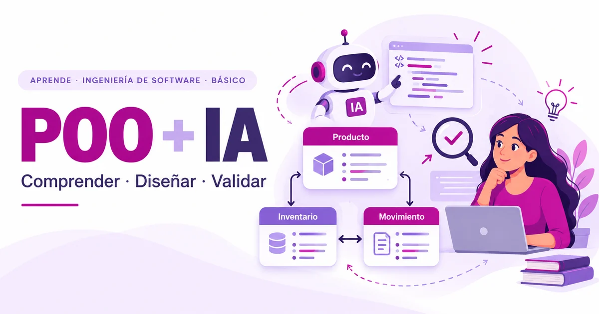

**Aprende · Ingeniería de Software · Nivel Básico · Fundamentos**

{fig-alt="Portada educativa clara, con el texto POO más IA, ilustraciones de una estudiante, un asistente y entidades de inventario."}

::: {.callout-tip title="Lo que aprenderás"}
Al finalizar la lectura podrás:

1. **Explicar** por qué aprender programación sigue siendo relevante aunque la IA pueda generar código.
2. **Reconocer** clases, objetos, atributos, métodos y principios básicos de la Programación Orientada a Objetos (POO).
3. **Relacionar** la POO con la organización de responsabilidades, la evolución y el mantenimiento de un sistema.
4. **Detectar y argumentar** posibles problemas de diseño en un ejemplo de código propuesto por IA.
5. **Distinguir** entre obtener una implementación y diseñar una solución que cumpla requisitos.
6. **Identificar** tareas de revisión, prueba y validación que siguen siendo necesarias al colaborar con agentes de programación.
:::

**Conocimientos previos:** no necesitas dominar POO. Te ayudará conocer variables, condicionales, funciones y estructuras de datos sencillas.

**Público destinatario:** estudiantes universitarios de Informática, Computación e Ingeniería de Software; docentes y personas que comienzan a programar.

**Tiempo estimado de lectura:** 14 minutos (aproximadamente 2979 palabras, a 220 palabras por minuto).

**Fecha editorial del texto:** 14 de octubre de 2026. Esta fecha identifica la planificación editorial; **no debe confundirse con la fecha de publicación en la web**, indicada en los metadatos del artículo cuando se publique.

## 1. Una pregunta que muchos estudiantes se hacen

Imagina que estás comenzando una asignatura de programación. Tu docente propone desarrollar un sistema para gestionar productos y existencias de un pequeño almacén. Pides ayuda a una herramienta de inteligencia artificial (IA) y, en poco tiempo, recibes varias clases, métodos y un programa que parece funcionar.

La primera impresión puede ser sorprendente: **«Si la IA lo escribió, ¿para qué necesito aprender a programar?»**.

Entonces cambia un requisito: ahora las entradas y salidas deben registrarse por separado, una cantidad negativa no debe aceptarse y la profesora te pide explicar qué responsabilidad cumple cada clase. Puedes solicitar otra respuesta a la IA, pero surge una pregunta más importante: **¿cómo sabes si la nueva propuesta es adecuada?**

Este escenario es **ficticio y didáctico**, no el resultado de una experiencia medida con estudiantes ni de un experimento con una herramienta concreta. Nos sirve para separar dos capacidades: *obtener código* y *comprender el software que ese código representa*.

La idea central de esta publicación es sencilla: **la IA puede ayudarte a escribir código; comprender el software te permite decidir qué construir, cómo evaluarlo y cuándo confiar en los resultados**.

## 2. La inteligencia artificial está cambiando la programación

Las herramientas actuales de IA pueden asistir en actividades como proponer fragmentos de código, explicar funciones, sugerir pruebas, refactorizar componentes y localizar posibles errores. Entre los ejemplos documentados se encuentran GitHub Copilot y Codex [1, 2].

Es útil distinguir dos experiencias:

- **Asistente de programación:** responde a consultas, sugiere fragmentos y acompaña la edición de código. La persona determina qué conservar y cómo incorporarlo.
- **Agente de programación:** puede, según sus herramientas y permisos, inspeccionar un repositorio, proponer un plan, modificar archivos, ejecutar comprobaciones y preparar cambios para revisión. **No todos los agentes disponen de las mismas capacidades ni acceso** [1, 2].

En ambos casos, la rapidez de generación no garantiza que se haya comprendido el problema ni que la solución cumpla todos los requisitos. Una propuesta puede compilar o producir una salida esperada y, aun así, omitir validaciones, duplicar responsabilidades o manejar incorrectamente datos sensibles.

La investigación sobre comprensión de código asistida por IA ha señalado oportunidades de apoyo educativo, pero también dificultades relacionadas con explicaciones incorrectas y con la capacidad de principiantes para evaluar esas respuestas [3]. Por eso, **aprender a revisar es tan importante como aprender a solicitar código**.

## 3. Programar no es solamente escribir código

Escribir instrucciones es una parte del trabajo. La Ingeniería de Software también implica comprender necesidades, analizar requisitos, diseñar estructuras, evaluar alternativas, probar comportamientos, mantener sistemas y gestionar cambios. Esas actividades se describen como áreas de conocimiento en SWEBOK, la guía de la IEEE Computer Society [4].

En nuestro almacén, antes de decidir si usaremos Python o qué clases crearemos, deberíamos responder:

- ¿Qué información identifica un producto?
- ¿Una entrada aumenta el inventario y una salida lo reduce?
- ¿Se permiten salidas que dejen existencias negativas?
- ¿Es necesario conservar un historial de movimientos?
- ¿Qué debería ocurrir si un código de producto no existe?
- ¿Cómo sabremos, con pruebas, que las reglas se cumplen?

Ninguna de estas decisiones queda resuelta automáticamente porque una IA produzca un archivo ejecutable. **Las decisiones de dominio y los criterios de aceptación orientan la implementación.**

::: {.callout-note title="Código que se ejecuta ≠ solución validada"}
Una prueba que pasa demuestra un comportamiento bajo ciertas condiciones, no que el sistema sea correcto en todos los escenarios. Además de observar resultados, necesitamos comprobar requisitos, casos límite, seguridad, claridad del diseño y facilidad de cambio.
:::

## 4. ¿Qué es la Programación Orientada a Objetos?

La **Programación Orientada a Objetos (POO)** es un paradigma que permite organizar parte del software mediante objetos que reúnen estado y comportamiento. En Python, las clases permiten definir tipos de objetos con atributos y métodos [5].

Para comprenderlo, pensemos en un producto del inventario:

| Concepto | Significado introductorio | Ejemplo |
|:--|:--|:--|
| **Clase** | Descripción de un tipo de objeto | Producto |
| **Objeto** | Instancia concreta de una clase | Producto con código P001 |
| **Atributo** | Información vinculada al objeto | código, nombre |
| **Método** | Comportamiento definido para el objeto | cambiar_nombre() |
| **Abstracción** | Conservar lo relevante para un problema | modelar producto sin representar toda la tienda |
| **Encapsulamiento** | Proteger las reglas mediante una interfaz coherente | modificar existencias mediante una operación que valide |
| **Herencia** | Especializar una clase a partir de otra cuando existe una relación adecuada | una especialización justificada por el dominio |
| **Polimorfismo** | Usar una misma interfaz con implementaciones apropiadas | distintos métodos de cálculo de costo |

No es necesario aplicar todos estos mecanismos en cada proyecto. En particular, **la herencia no es obligatoria**: muchas soluciones son más claras con colaboración entre objetos o con funciones simples.

En Python, un guion bajo en un atributo expresa una **convención de uso interno**, no una barrera de privacidad absoluta. Entender estas particularidades evita confundir un principio de diseño con una garantía del lenguaje [5].

## 5. ¿Por qué aprender POO si la IA puede generar clases y objetos?

Supongamos que la IA propone una clase que controla productos, usuarios, facturas, reportes y envíos. El código puede ejecutarse, pero probablemente será difícil localizar las reglas de cada proceso o modificar una parte sin afectar otra.

Con conocimientos de POO puedes **preguntar por qué** cada responsabilidad está en un lugar y si la relación entre componentes tiene sentido. Esa capacidad ayuda a:

- **Modelar el dominio:** representar conceptos reconocibles del problema real.
- **Separar responsabilidades:** distinguir operaciones de inventario, datos del producto y registro de movimientos.
- **Encapsular reglas:** validar cantidades y transiciones de estado desde operaciones conocidas.
- **Facilitar pruebas:** comprobar piezas pequeñas con entradas y resultados claros.
- **Evolucionar el sistema:** agregar requisitos sin reescribir indiscriminadamente todo.
- **Revisar propuestas de IA:** justificar cambios, detectar suposiciones y contrastarlas con requisitos.

La reutilización y la modularidad pueden ser beneficios de un diseño adecuado, **pero la sola existencia de clases no garantiza calidad**. También es posible crear demasiadas clases o relaciones innecesarias.

Aprender POO no consiste en memorizar vocabulario para competir con un generador de código. Consiste en desarrollar **criterio para reconocer un diseño comprensible y defendible**.

## 6. Un ejemplo: el sistema de inventario

Tomemos tres conceptos del dominio:

**Producto** conserva la identificación y datos descriptivos de un artículo. **Inventario** conoce las existencias y aplica las reglas para registrar cambios. **MovimientoInventario** representa un registro de entrada o salida, con cantidad, tipo y referencia al producto.

### Un diagrama de clases para discutir el diseño

~~~{mermaid}
classDiagram
direction LR
class Producto {
    +str codigo
    +str nombre
}
class Inventario {
    -dict existencias
    +registrar_entrada(codigo, cantidad)
    +registrar_salida(codigo, cantidad)
    +consultar_existencia(codigo) int
}
class MovimientoInventario {
    +str codigo_producto
    +str tipo
    +int cantidad
}
Inventario "1" --> "0..*" Producto : mantiene existencias
Inventario "1" --> "0..*" MovimientoInventario : registra
MovimientoInventario "0..*" --> "1" Producto : se refiere a
~~~

*Figura 1. Modelo UML conceptual simplificado del inventario. Las flechas expresan asociaciones para comprender responsabilidades; no representan tablas de una base de datos ni una implementación terminada. [UML, OMG] [6].*

**Alternativa textual del diagrama:** un Inventario registra existencias de cero o más Productos y puede registrar cero o más MovimientosInventario; cada movimiento se refiere a un Producto. El modelo deja fuera persistencia, transacciones, usuarios y otros requisitos reales.

### Un fragmento ilustrativo en Python

~~~python
class Producto:
    def __init__(self, codigo: str, nombre: str):
        self.codigo = codigo
        self.nombre = nombre

class Inventario:
    def __init__(self):
        self._existencias = {}

    def registrar_entrada(self, codigo: str, cantidad: int):
        if cantidad <= 0:
            raise ValueError("La cantidad debe ser positiva")
        actual = self._existencias.get(codigo, 0)
        self._existencias[codigo] = actual + cantidad
~~~

El ejemplo muestra una decisión: **la validación de cantidades pertenece a la operación que modifica las existencias**. Si otro componente quisiera registrar una entrada, usaría esa operación en vez de cambiar libremente el diccionario.

Es código de apoyo conceptual, **no un sistema completo ni un experimento ejecutado con IA**. Todavía faltan comprobar productos registrados, salidas, persistencia, auditoría y concurrencia. Esas omisiones son oportunidades para preguntar por los requisitos, no razones para considerar terminado el diseño.

## 7. Cuando la IA genera código que funciona, pero está mal diseñado

Imagina ahora una **propuesta hipotética**, atribuida solo para la discusión a un generador de código: una clase llamada GestorGeneral almacena productos, modifica existencias, imprime facturas, envía correos y calcula estadísticas. También repite la misma validación de cantidades en diferentes métodos.

Al usarla una vez, puede parecer suficiente. Cuando el sistema crece surgen preguntas: ¿cómo pruebas el inventario sin ejecutar el envío de correo? ¿Qué ocurre si cambia la política de facturación? ¿En cuántos lugares debe corregirse la validación?

Estas señales suelen denominarse *olores de código* (*code smells*): indicios que invitan a estudiar un posible problema de diseño, **no pruebas automáticas de que todo está mal** [7].

| Señal en la propuesta | Qué conviene investigar | Posible mejora |
|:--|:--|:--|
| Una clase hace demasiadas cosas | ¿Hay responsabilidades sin relación? | Separar componentes con objetivos claros |
| La validación se repite | ¿Las reglas divergen entre métodos? | Centralizar reglas de negocio |
| Relaciones de herencia forzadas | ¿Existe realmente una relación «es un»? | Preferir colaboración cuando corresponda |
| Una prueba depende de correo y base de datos | ¿Las responsabilidades están acopladas? | Definir interfaces y aislar dependencias |
| La IA supone reglas no solicitadas | ¿Se cumplió la especificación? | Revisar requisitos y criterios de aceptación |

**Ejemplo de criterio verificable:** «No se permite registrar una entrada con cantidad cero o negativa». Podemos revisar la operación correspondiente y diseñar casos de prueba para cantidades positivas, cero y negativas.

Aquí aparece la diferencia entre **aceptar una salida** y **evaluar una solución**. La segunda exige entender qué problema se resuelve, cómo se organiza y cómo se comprobará. La investigación sobre asistentes de código muestra que comprender y revisar sus soluciones es un tema educativo y técnico relevante, no un trámite opcional [3, 8].

## 8. De la POO a la Ingeniería de Software asistida por agentes

Los agentes de programación extienden ciertas formas de asistencia: pueden recibir una tarea, inspeccionar archivos, proponer modificaciones y, en entornos habilitados, ejecutar pruebas y preparar un Pull Request [1, 2]. Eso no elimina la necesidad de especificar qué se desea ni de comprobar lo entregado.

Un recorrido introductorio de trabajo responsable podría verse así:

1. **Comprender el dominio:** qué significan Producto, Inventario y MovimientoInventario.
2. **Definir requisitos:** por ejemplo, impedir existencias negativas y guardar movimientos.
3. **Diseñar:** asignar responsabilidades y representar relaciones mediante UML.
4. **Establecer criterios de aceptación:** describir casos normales, límite y de error.
5. **Colaborar con IA:** solicitar alternativas, explicaciones, código o propuestas de prueba.
6. **Verificar:** inspeccionar cambios, ejecutar comprobaciones y documentar límites.

En el ecosistema YaskCode, **YASE — YaskCode Agentic Engineering Studio** es una iniciativa educativa orientada a explorar ese aprendizaje supervisado y basado en evidencias. Aquí se menciona como contexto pedagógico, **no como demostración de capacidades, resultados o impacto que no se han validado**.

**Delegar tareas no equivale a delegar la responsabilidad académica o profesional.** La persona que incorpora código al proyecto debe poder justificar las decisiones y comprobar sus consecuencias.

## 9. ¿Qué debería aprender un estudiante antes de delegar programación a la IA?

No es necesario prohibir la IA hasta «saberlo todo». Una ruta más útil es aprender fundamentos y utilizar las herramientas progresivamente, con apoyo y comprobación.

| Paso | Pregunta de aprendizaje | Evidencia de comprensión |
|:--|:--|:--|
| Fundamentos de programación | ¿Qué hace el programa? | Explicar condiciones, funciones y estructuras |
| Programación Orientada a Objetos | ¿Quién es responsable de qué? | Identificar objetos, atributos, métodos y reglas |
| Modelado UML | ¿Cómo se relacionan las partes? | Leer y justificar un diagrama sencillo |
| Diseño y arquitectura | ¿Qué alternativa conviene? | Comparar organización y dependencias |
| Pruebas y calidad | ¿Cómo sabremos si cumple? | Proponer casos y analizar fallos |
| IA y agentes | ¿Qué delegar y qué verificar? | Revisar cambios y documentar evidencia |

Esta secuencia es **una propuesta didáctica de YaskCode**, no una norma que exija dominar una etapa por completo antes de practicar la siguiente. Se puede usar IA desde el inicio para preguntar, contrastar explicaciones y examinar código, siempre que se conserve una actitud crítica.

## 10. ¿La POO es siempre la mejor opción?

**No.** También existen los enfoques procedurales, funcionales, declarativos y combinaciones de paradigmas. Una transformación corta de datos puede resolverse con funciones claras sin necesidad de construir un sistema de clases. Otros problemas tienen entidades con reglas y colaboraciones que pueden resultar más comprensibles mediante objetos.

Elegir un paradigma requiere valorar el dominio, la escala, el equipo, las tecnologías y los requisitos. Aprender POO amplía las opciones de diseño, pero **no obliga a utilizarla en todos los programas**.

Ser competente significa saber cuándo un enfoque ayuda y cuándo introduce complejidad innecesaria.

## 11. Comprueba lo aprendido

Estas preguntas sirven para reflexionar sobre situaciones próximas a la práctica. No son un examen formal; compara tu razonamiento con la orientación.

1. **¿Por qué no es suficiente que un código generado por IA funcione al ejecutarlo una vez?**

   *Orientación:* piensa en requisitos omitidos, casos límite, seguridad, mantenibilidad y evidencia de pruebas.

2. **¿Cómo ayudan las clases y los objetos a organizar las responsabilidades del inventario?**

   *Orientación:* diferencia información de productos, operaciones sobre existencias y registro de movimientos.

3. **¿Qué riesgo tiene reutilizar un código que no comprendemos?**

   *Orientación:* considera qué ocurriría ante un cambio de requisitos, un error o una decisión que debas justificar.

4. **Un generador pone facturas, correos, stock y reportes dentro de Inventario. ¿Cómo evaluarías ese diseño?**

   *Orientación:* identifica responsabilidades distintas, dependencias y posibilidades de prueba; no supongas que «más clases» es siempre mejor.

5. **¿Qué responsabilidades conserva una persona cuando trabaja con un agente de programación?**

   *Orientación:* incluye especificación, permisos, revisión de cambios, pruebas, protección de datos y aprobación final.

## 12. Conclusión: aprender POO sigue teniendo sentido

La inteligencia artificial está ampliando las maneras de producir software. Eso puede hacer más rápida una primera implementación y ofrecer nuevas oportunidades de aprendizaje. Pero **generar código no es lo mismo que comprender, diseñar y validar una solución**.

Aprender POO te da un lenguaje para pensar en entidades, reglas, responsabilidades y colaboraciones. Ese conocimiento puede ayudarte a revisar las propuestas de una IA, dialogar con otras personas desarrolladoras y construir sistemas que puedan cambiar sin perder coherencia.

El objetivo no es competir con la rapidez de un generador de código. Es desarrollar las bases para tomar **decisiones técnicas comprensibles, críticas y responsables**.

En YaskCode lo expresamos así: **«Aprender Ingeniería de Software haciendo Ingeniería de Software».**

### Continúa aprendiendo: de la idea al laboratorio Practica

**Próximamente · Practica**

**«Diseña y construye un sistema orientado a objetos con apoyo de IA»** será el laboratorio complementario de este artículo.

Allí analizaremos un problema de inventario, identificaremos clases y responsabilidades, elaboraremos un UML, implementaremos una solución en Python, compararemos decisiones con propuestas de IA, ejecutaremos pruebas y documentaremos resultados. Los retos **Construye** serán progresivos: **Básico** (clases y operaciones esenciales), **Intermedio** (mejoras y funcionalidades) y **Avanzado** (refactorización, pruebas y evaluación crítica del código sugerido). Todavía no está publicado; por eso no creamos un enlace.

### Comparte con la comunidad

**¿Crees que la IA hace menos necesario aprender programación, o hace todavía más importante comprender el código que utilizamos?** Comparte tu argumento o una experiencia de aprendizaje en las [Discussions de YaskCode Community](https://github.com/orgs/YaskCode-community/discussions).

Puedes utilizar ejemplos ficticios, públicos o autorizados. Evita incluir código privado, claves, documentos confidenciales o datos de otras personas.

### Referencias y documentación

[1] GitHub. *About GitHub Copilot agents*. Documentación oficial. <https://docs.github.com/en/copilot/concepts/agent-capabilities/about-agents/about-github-copilot-agents>

[2] OpenAI. (2025). *Introducing Codex*. Presentación y alcances iniciales del agente, sujetos a cambios posteriores. <https://openai.com/index/introducing-codex/>

[3] Qiao, Y., Shihab, M. I. H., y Hundhausen, C. (2026). *A Systematic Literature Review of the Use of GenAI Assistants for Code Comprehension: Implications for Computing Education Research and Practice*. ACM Transactions on Computing Education. <https://doi.org/10.1145/3785366>

[4] IEEE Computer Society. *Guide to the Software Engineering Body of Knowledge (SWEBOK), versión 4.0/4.0a*. Información general y áreas de conocimiento. <https://www.computer.org/education/bodies-of-knowledge/software-engineering>

[5] Python Software Foundation. *The Python Tutorial — Classes*. Documentación oficial. <https://docs.python.org/3/tutorial/classes.html>

[6] Object Management Group (OMG). *Unified Modeling Language (UML), versión 2.5.1*. Especificación oficial. <https://www.omg.org/spec/UML/2.5.1>

[7] Fowler, M. (2006). *Code Smell*. Ensayo de diseño y refactorización. <https://martinfowler.com/bliki/CodeSmell.html>

[8] Jimenez, C. E., et al. (2024). *SWE-bench: Can Language Models Resolve Real-world GitHub Issues?* ICLR. Investigación sobre evaluación de tareas de Ingeniería de Software, no una medida del presente ejemplo didáctico. <https://proceedings.iclr.cc/paper_files/paper/2024/hash/edac78c3e300629acfe6cbe9ca88fb84-Abstract-Conference.html>

**Nota de autoría y transparencia:** contenido conceptual preparado para Blog YaskCode con asistencia de IA en redacción y portada. El ejemplo de inventario es hipotético; no se reportan experimentos ni métricas de estudiantes. La revisión académica, aceptación y publicación corresponden a Yaskelly Yedra.
