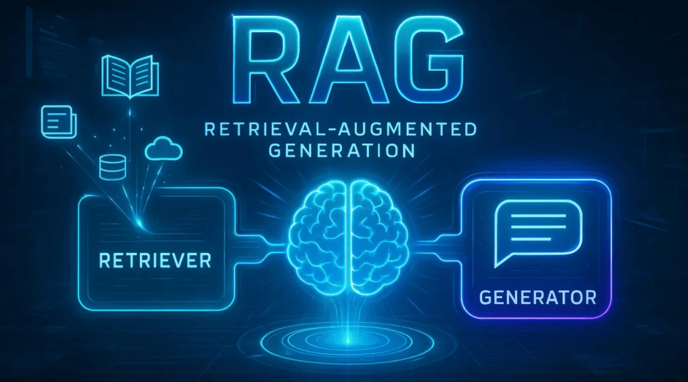
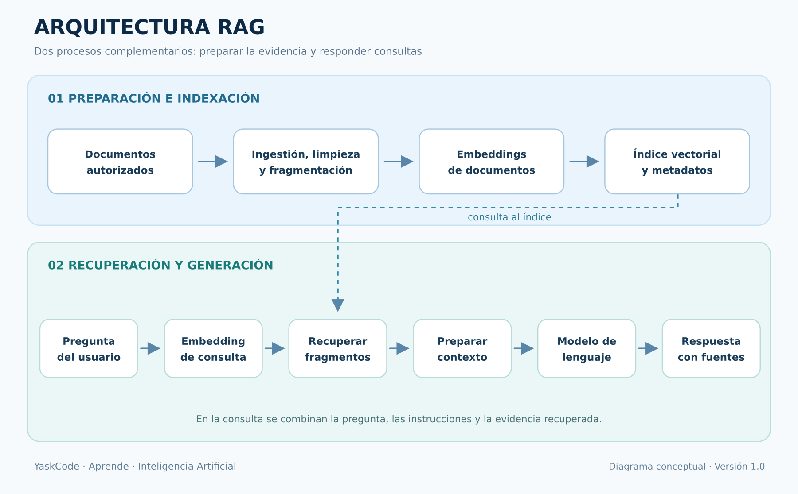

**Aprende · Inteligencia Artificial · Nivel Básico · Fundamentos**

::: {.callout-note title="En 1 minuto"}
RAG combina **recuperación de información externa** y **generación de respuestas** para que un modelo pueda apoyarse en documentos pertinentes. Sus dos recorridos son preparar e indexar fuentes y, después, recuperar evidencia durante una consulta. La calidad depende de los documentos, las citas, la seguridad y la verificación: RAG **no garantiza por sí solo respuestas correctas**.
:::

::: {.callout-tip title="Lo que aprenderás"}
Al finalizar la lectura podrás:

1. **Explicar** qué es RAG, qué problema resuelve y por qué una respuesta necesita evidencia pertinente.
2. **Identificar** las piezas de una arquitectura RAG introductoria: fuentes, fragmentos, embeddings, índice, recuperador y generador.
3. **Diferenciar** el proceso de preparación e indexación del proceso de recuperación y generación durante una consulta.
4. **Comparar** RAG y *fine-tuning* y **justificar** cuándo conviene cada enfoque.
5. **Reconocer** limitaciones de privacidad, seguridad y calidad, y **proponer** comprobaciones básicas de evidencia y fidelidad.
:::

### Antes de comenzar

**Conocimientos previos:** no necesitas haber implementado RAG. Conviene conocer las nociones generales de IA generativa y modelos de lenguaje.

**Público destinatario:** estudiantes, docentes, desarrolladores y personas interesadas en comenzar con RAG.

::: {.callout-tip title="Recursos para llevar"}
<a href="../../recursos/rag-fundamentos-arquitectura-ficha.md" download>Descargar ficha de lectura (.md)</a> · La opción «Imprimir o guardar como PDF» aparecerá junto al encabezado.

La ficha sintetiza las ideas clave y propone preguntas para revisar la comprensión; **no sustituye un laboratorio**.
:::

## 1. ¿Por qué un modelo de lenguaje necesita información externa?

Imagina que preguntas a un asistente de inteligencia artificial: «¿Cuál es la fecha de entrega del proyecto final de mi asignatura?». Puede responder con seguridad aparente, pero sin consultar el cronograma carece de evidencia.

Los **modelos de lenguaje de gran tamaño** (*Large Language Models*, LLM) aprenden patrones durante su entrenamiento. Ese conocimiento puede ser amplio, pero no incluye necesariamente los documentos de una universidad, los cambios recientes en un reglamento o las últimas versiones de un manual. Una respuesta fluida no necesariamente es verdadera.

La **generación aumentada por recuperación** (*Retrieval-Augmented Generation*, **RAG**) aborda este problema conectando la generación de lenguaje con la búsqueda de información externa pertinente.

## 2. ¿Qué es RAG?

**RAG** es un enfoque que combina dos capacidades: recuperar información relevante de una fuente externa y utilizarla como contexto para generar una respuesta.

El trabajo de Lewis y colaboradores (2020) presentó una arquitectura influyente que combinaba un modelo generativo con una memoria externa consultable mediante recuperación neuronal \[1\]. Hoy, el término RAG también se aplica a otras implementaciones que integran buscadores, índices y diferentes modelos de lenguaje.

Una analogía útil es un examen con material de consulta: en lugar de responder únicamente de memoria, el estudiante localiza las páginas pertinentes y construye su explicación a partir de ellas. **La analogía es imperfecta:** un sistema RAG puede interpretar mal lo encontrado o producir afirmaciones que las fuentes no respaldan.

## 3. Recuperar información no es lo mismo que generar respuestas

En la **recuperación**, el sistema localiza fragmentos relacionados con la pregunta. Por ejemplo, ante «¿cómo se evalúa el segundo parcial?», encuentra una sección de la guía docente que describe sus criterios. Un recuperador no necesita redactar la respuesta: selecciona evidencia candidata.

En la **generación**, el LLM recibe la pregunta, instrucciones y fragmentos recuperados. Con esos elementos redacta una explicación comprensible. Si la aplicación conserva el origen de cada fragmento, puede mostrar referencias para que el lector compruebe la información.

Por eso, **similitud semántica no equivale a exactitud factual**. Encontrar un párrafo relacionado es solo el primer paso; después hay que comprobar que realmente permite responder.

### Ilustración conceptual: recuperar y generar

{fig-alt="Ilustración en tonos azules sobre fondo oscuro: a la izquierda aparecen símbolos de documentos, base de datos y nube junto al bloque Retriever; un cerebro simbólico de IA conecta con el bloque Generator a la derecha."}

*Ilustración conceptual. El recuperador localiza información pertinente y el modelo generador utiliza el contexto recuperado para elaborar una respuesta. El cerebro es una representación simbólica de la IA; esta imagen simplifica el proceso y no muestra todos los componentes de una arquitectura RAG.*

## 4. Aprende: fundamentos y arquitectura de un sistema RAG

Una arquitectura introductoria puede organizarse en siete componentes:

1.  **Fuentes de datos:** programas de asignaturas, manuales, guías, páginas web o documentos autorizados.

2.  **Ingestión:** lectura, extracción de texto y registro del origen, fecha o permisos de cada documento.

3.  **Segmentación (*chunking*):** división del contenido en fragmentos manejables, procurando conservar su significado.

4.  **Embeddings:** representaciones numéricas que permiten comparar relaciones semánticas entre preguntas y fragmentos.

5.  **Índice vectorial:** estructura que facilita encontrar vectores similares y vincularlos con los textos originales. No siempre exige una base de datos vectorial independiente.

6.  **Recuperación y contexto:** selección de fragmentos pertinentes y preparación de un mensaje que combina pregunta, instrucciones y evidencia.

7.  **Generación:** producción de la respuesta por el LLM, idealmente acompañada de referencias verificables.

El diagrama muestra un diseño didáctico basado en búsqueda vectorial, no la única arquitectura posible. También existen recuperaciones por palabras clave o híbridas \[2–5\].

### Diagrama conceptual de arquitectura RAG

{fig-alt="Arquitectura RAG: los documentos se preparan e indexan; la consulta recupera evidencia para generar una respuesta."}

*Figura 1. Los documentos se procesan e indexan previamente; durante una consulta se recupera evidencia y se genera una respuesta. Las referencias deben construirse a partir de los metadatos reales, no inventarse.*

## 5. Dos procesos, una arquitectura

### Preparación e indexación

Antes de atender consultas, se seleccionan las fuentes permitidas, se extrae su contenido, se limpia y se divide en fragmentos. Un modelo de embeddings representa los fragmentos mediante vectores; el sistema los incorpora a un índice junto con identificadores y metadatos de procedencia. Si cambia una guía, es necesario actualizar los elementos afectados del índice. La calidad de esta preparación condiciona lo que podrá recuperarse después \[3\].

### Recuperación y generación durante la consulta

Cuando llega una pregunta, se prepara una representación compatible con los documentos indexados. El recuperador selecciona fragmentos; opcionalmente se filtran o reordenan. Luego se construye el contexto que recibe el LLM para formular la respuesta \[4\]. Ante evidencia insuficiente, debería evitar las suposiciones.

**Importante:** no todas las aplicaciones emplean exactamente estas etapas o el mismo tipo de índice. Es un modelo de referencia para comenzar.

## 6. RAG en el aula: un asistente para una asignatura

Supongamos que la asignatura «Ingeniería de Software» dispone de un programa, un cronograma y una guía de evaluación. El objetivo es construir un asistente que responda únicamente con información de esos documentos.

1.  **Preparar:** el docente incorpora versiones autorizadas de los tres archivos y registra su fecha.

2.  **Indexar:** el sistema extrae el texto, crea fragmentos y genera sus embeddings.

3.  **Preguntar:** un estudiante escribe: «¿Qué debo entregar en la segunda evaluación?».

4.  **Recuperar:** el buscador encuentra los apartados del cronograma y la guía relacionados con la evaluación.

5.  **Responder:** el modelo resume los entregables mencionados e identifica el documento y la sección que los respaldan.

6.  **Verificar:** el estudiante abre la guía original y confirma los requisitos.

Si los documentos contienen información contradictoria, el asistente debería señalar la discrepancia. Si no existe un apartado sobre la segunda evaluación, la respuesta apropiada es reconocer que no se encontró suficiente información. Este ejemplo es hipotético; **no representa un sistema implementado ni resultados medidos**.

## 7. RAG y fine-tuning: ¿cuándo utilizar cada uno?

El **fine-tuning** o *ajuste fino* adapta un modelo mediante entrenamiento adicional, modificando pesos del modelo o entrenando parámetros adicionales para mejorar su desempeño en ciertas tareas. RAG, en cambio, aporta información mediante recuperación durante la consulta. No son técnicas equivalentes ni excluyentes \[6\].

| Criterio                 | RAG                                  | Fine-tuning                                                  |
|--------------------------|--------------------------------------|--------------------------------------------------------------|
| Propósito habitual       | Consultar información externa        | Adaptar comportamiento o desempeño                           |
| Cambios en el modelo     | No son necesarios para el RAG básico | Requiere entrenamiento de parámetros                         |
| Actualización documental | Actualizar fuentes e índice          | Puede requerir nuevo ajuste; no es un repositorio documental |
| Ejemplo universitario    | Responder según la guía vigente      | Adaptar un modelo a una tarea o formato recurrente           |
| Desafío principal        | Recuperar evidencia adecuada         | Disponer de datos y evaluación de entrenamiento              |

Pueden combinarse. Antes de elegir, conviene definir si el problema es **acceder a información** o **mejorar el comportamiento del modelo**.

## 8. Ventajas, limitaciones y riesgos

RAG permite trabajar con colecciones documentales específicas, actualizar fuentes sin reentrenar necesariamente el LLM y ofrecer trazabilidad cuando se conservan referencias. Sin embargo, añade componentes que deben mantenerse y evaluarse.

Entre sus problemas frecuentes están los documentos incompletos o desactualizados, la segmentación que separa una idea de su contexto, la recuperación de fragmentos irrelevantes y las respuestas que incorporan afirmaciones sin respaldo. Un fragmento parecido a la pregunta no siempre contiene su respuesta.

La **privacidad y la seguridad** requieren atención especial. Los documentos deben tener permisos de acceso; no basta con confiar en que el modelo omitirá información confidencial. Además, textos recuperados pueden incluir instrucciones maliciosas destinadas a manipular la respuesta, un riesgo relacionado con la *inyección de instrucciones* (*prompt injection*) y la contaminación documental abordados por el proyecto de seguridad de aplicaciones OWASP \[7\].

Evaluar un sistema RAG implica observar, por separado, **si recuperó la evidencia correcta** y **si la respuesta se mantuvo fiel a esa evidencia**. Un piloto docente debería incluir preguntas verificables, casos sin respuesta y pruebas de acceso restringido, además de registrar errores y costos.

Una evaluación inicial puede observar **pertinencia de los fragmentos recuperados**, **fidelidad de cada afirmación a esos fragmentos**, **correspondencia entre citas y documentos originales** y **capacidad de reconocer evidencia insuficiente**. Son criterios conceptuales: no se han calculado métricas ni probado un prototipo para este artículo.

## 9. Primeros pasos con herramientas abiertas

Una primera práctica no necesita grandes volúmenes de datos. Puede realizarse con unos pocos documentos públicos o creados para el ejercicio y un entorno Python:

- **Hugging Face:** materiales gratuitos para aprender búsqueda semántica y experimentar con conjuntos de datos \[5\].

- **Sentence Transformers:** modelos y herramientas para generar embeddings y comparar consultas con fragmentos \[8\].

- **FAISS:** biblioteca de código abierto para indexar vectores y buscar similitudes; no es, por sí sola, una plataforma completa de gestión documental \[9\].

- **LlamaIndex:** documentación y componentes opcionales para organizar la ingestión, el índice y las consultas \[3–4\].

Como ejercicio inicial, selecciona una guía académica de acceso público, formula diez preguntas comprobables y anota qué fragmentos recupera el sistema. Compara esas evidencias con las respuestas obtenidas. Antes de subir documentos a servicios externos, revisa licencias, permisos y condiciones de tratamiento de datos.

## 10. Conclusiones: del concepto al primer prototipo

RAG no convierte automáticamente a un modelo de lenguaje en una fuente confiable. Su aporte es ofrecer un mecanismo para **buscar evidencia antes de responder**, facilitando aplicaciones que trabajan con documentación específica y cambiante.

El punto de partida más útil no es elegir la base vectorial más compleja, sino definir qué documentos se necesitan, qué preguntas deberían responderse y cómo se comprobará la calidad de cada respuesta. Con un conjunto pequeño y bien preparado es posible estudiar todo el proceso y detectar sus limitaciones.

En YaskCode continuaremos este recorrido desde la explicación conceptual hacia prácticas reproducibles y proyectos abiertos. [**Explora los recursos abiertos de YaskCode en GitHub**](https://github.com/YaskCode) y construye tu primer experimento RAG con documentos que puedas verificar.

### Glosario esencial

- **Chunk:** fragmento de un documento utilizado como unidad de recuperación.

- **Embedding:** representación numérica aprendida para comparar información.

- **Índice vectorial:** estructura para organizar y buscar representaciones vectoriales.

- **Recuperador (*retriever*):** componente que selecciona información candidata para responder.

- **Contexto:** información e instrucciones proporcionadas al modelo en una consulta.

### Comprueba lo aprendido

Estas preguntas permiten comprobar la comprensión y aplicar los conceptos a situaciones sencillas. No son un examen formal; intenta justificar cada respuesta antes de leer la orientación.

1. **Un asistente recupera un párrafo relacionado con la pregunta, pero no encuentra allí la fecha solicitada. ¿Puede generar una fecha como respuesta?**

   *Orientación:* distingue relevancia temática de evidencia suficiente. Una respuesta sustentada debe reconocer cuándo el dato no aparece.

2. **Una universidad actualiza la guía de una asignatura. ¿Qué parte del sistema RAG habría que revisar y por qué no equivale a hacer fine-tuning?**

   *Orientación:* piensa en fuentes, fragmentos e índice; el ajuste fino modifica parámetros del modelo, no sustituye el mantenimiento del repositorio documental.

3. **Un docente necesita respuestas basadas en normas académicas vigentes y, además, un formato consistente de salida. ¿Cuándo usarías RAG, fine-tuning o ambos?**

   *Orientación:* separa la necesidad de consultar información actualizada de la de adaptar el comportamiento o el formato de un modelo.

4. **Dos documentos autorizados ofrecen fechas contradictorias. ¿Qué debería mostrar el asistente y cómo comprobarías su confiabilidad?**

   *Orientación:* considera procedencia, fecha, versión, permisos, citas y reconocimiento explícito de la discrepancia.

### Continúa aprendiendo: lleva RAG a la práctica

**Próximamente · Practica**

**«Tu primer sistema RAG: laboratorio guiado»** será la siguiente publicación de esta ruta temática. Construiremos un ejemplo reproducible con documentos permitidos, exploraremos la recuperación de fragmentos, examinaremos qué respalda cada respuesta y registraremos resultados y limitaciones.

El laboratorio incluirá **retos Construye de nivel Básico, Intermedio y Avanzado**, para ampliar el prototipo de forma progresiva. **Todavía no está publicado**, por lo que no incluimos un enlace inexistente.

### Comparte con la comunidad

¿Qué preguntas intentarías responder con RAG? ¿Cómo comprobarías que una respuesta está respaldada por documentos reales? Puedes compartir una reflexión, duda o aprendizaje en las [Discussions de YaskCode Community](https://github.com/orgs/YaskCode-community/discussions).

Utiliza ejemplos públicos, sintéticos o autorizados; no compartas documentos confidenciales, datos personales, credenciales ni información restringida.

### Referencias académicas y técnicas

\[1\] Lewis, P., et al. (2020). *Retrieval-Augmented Generation for Knowledge-Intensive NLP Tasks*. NeurIPS 33. <https://papers.nips.cc/paper_files/paper/2020/hash/6b493230205f780e1bc26945df7481e5-Abstract.html>

\[2\] Hugging Face. *RAG — Transformers*. <https://huggingface.co/docs/transformers/model_doc/rag>

\[3\] LlamaIndex. *Indexing*. <https://developers.llamaindex.ai/python/framework/module_guides/indexing/>

\[4\] LlamaIndex. *Querying*. <https://developers.llamaindex.ai/python/framework/understanding/rag/querying/>

\[5\] Hugging Face. *Semantic search with FAISS*. <https://huggingface.co/learn/llm-course/en/chapter5/6>

\[6\] Huizenga, E., y Hu, M. (2024). *When to use supervised fine-tuning for Gemini*. Google Cloud. <https://cloud.google.com/blog/products/ai-machine-learning/supervised-fine-tuning-for-gemini-llm>

\[7\] OWASP. *Top 10 for LLMs and Generative AI Applications (2025)*. <https://genai.owasp.org/llm-top-10/>

\[8\] Sentence Transformers. *Semantic Search*. <https://www.sbert.net/examples/sentence_transformer/applications/semantic-search/README.html>

\[9\] Meta FAIR. *FAISS*. <https://github.com/facebookresearch/faiss>
